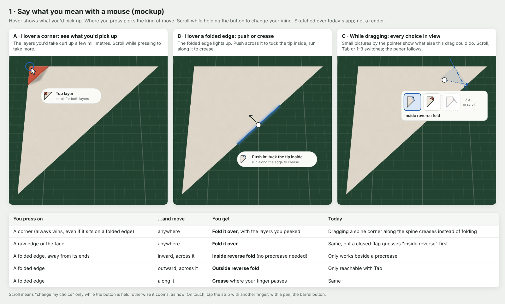
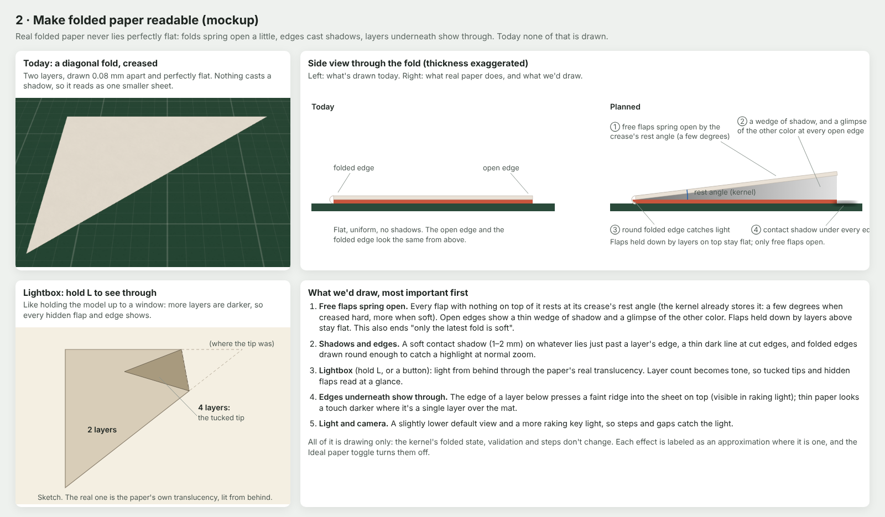

# Phase 1 polish: plan for review

Two fixes before Phase 2, from your review of Phase 1. Nothing here is built yet; this is the plan to
approve or change.

1. **Say what you mean with a mouse.** Grabbing a corner or an edge should do what you meant, and
   you should see what that will be before and during the drag.
2. **Make folded paper readable.** After folding and creasing, the model looks like a smaller blank
   sheet. It should show its layers and folds the way real paper does.

---

## 1 · Say what you mean with a mouse

### What's wrong today

I checked this in the app while writing the plan.

- **The app guesses from the drag alone.** It reads the drag's line, then picks a meaning: on a closed
  flap it guesses "inside reverse fold" first, even though folding the whole flap over is more
  common. The other readings are behind Tab, which you have to know about.
- **A corner on a folded edge gets misread.** Fold a square into a triangle, then grab one end of
  the folded edge and drag it onto the other end to fold the triangle in half (the classic next
  step). The app reads that as "run your finger along the fold to crease it", because you pressed on
  the folded edge and moved along it. Nothing folds, and the timeline gains two entries named "Fold"
  that changed nothing.
- **You can't see which layers you'll pick up** until you're already dragging.

In real life none of this is ambiguous: you know whether you're pinching a corner or pushing on an
edge, and you feel how many layers are between your fingers. A mouse has none of that, so the screen
has to show it.

### The idea: where you touch says what you mean

**1. Hover shows what you'd pick up, before you press.**

- **Corner:** a ring on the corner, and the layers you'd take curl up a few millimetres, like lifting
  a page corner with a fingernail. A small badge says "Top layer" or "2 layers".
- **Folded edge:** the edge lights up and the cursor becomes a push. The badge says "Push in: tuck the
  tip inside", with "run along the edge to crease" under it.
- **Raw edge or the face:** the grab cursor, and the same small curl near the pointer.

**2. Where you press picks the kind of move.**

| You press on | …and move | You get |
| --- | --- | --- |
| A corner (always wins, even on a folded edge) | anywhere | Fold it over, with the layers you saw curl |
| A raw edge or the face | anywhere | Fold it over |
| A folded edge, away from its ends | inward, across it | Inside reverse fold |
| A folded edge | outward, across it | Outside reverse fold |
| A folded edge | along it | Crease where your finger passes |

- **Reverse folds stop needing a precrease.** Pushing the folded edge from one point to another folds
  along the line that takes the first point to the second, the same way corners fold. It snaps to
  precreases and landmarks like every other fold, and the kernel still decides what's possible.
- **Inward or outward picks inside or outside.** For a given line only one of the two is physically
  possible anyway (kernel rule, ADR-024), and the direction you push matches it.

**3. Change your mind without letting go.**

- **Scroll while the button is down** to step through what else this drag could mean: before you
  move, it changes how many layers you take; during the drag, it switches between top layer, more
  layers, all layers and the reverse folds. The paper follows live.
- **A strip of small pictures by the pointer** shows the choices: the current one is highlighted,
  impossible ones are hidden. Tab and the keys 1–4 still work.
- **On touch,** tap the strip with another finger. **With a pen,** use the barrel button.
- The scroll wheel keeps zooming whenever the button isn't held.

**4. It remembers.** The app keeps what you picked last for each kind of press (corner, edge, folded
edge) and leads with it next time, if it's valid.

**5. It teaches once.** After the first closed flap appears, one first-run hint: "Push a folded
edge to tuck the tip in."

### How I'd build it

- **Intent:** sort a press into a zone (corner within ~14 px, which beats an edge; folded edge within
  ~10 px, away from its ends; raw edge; face). Grabs never turn into crease strokes. Pushes on a
  folded edge make reverse-fold candidates from the press and pointer positions, inside or outside by
  direction. The order of candidates depends on the zone.
- **Worker:** a `peek` request returns a tiny fold of the layers you'd take near the pointer
  (validated like any move, cached). The skin draws it a few degrees open while you hover.
- **App:** hover feedback (ring, edge glow, cursor, badge), scroll while the button is held, the
  picture strip (one small SVG per kind of move), keys 1–4, a tap target for touch, pen barrel.
- **Kernel:** a crease stroke that changes nothing is refused, so it can't add empty timeline entries.
  A crease that sharpens a fold is always named "Crease".
- **Strings** for the badges and hints, in the brief's voice.

### How I'd test it

- **Unit tests:** zone detection (corner beats edge), push lines and their inside/outside kind, the
  candidate order per zone.
- **Playwright:**
  - Fold the triangle in half by dragging one corner of the folded edge onto the other: it folds, it
    doesn't crease.
  - Push the folded edge in: an inside reverse fold with no precrease. Push it out: an outside one.
  - Scroll before moving: the badge changes from "Top layer" to "2 layers", and the fold takes both.
  - Hovering a folded edge shows the push badge.

### Where this departs from the brief

The brief has one fixed order for Tab (inside reverse, outside reverse, both layers, top layer). Here
the first guess comes from where you press, and the rest are in the strip. I'd record that as an ADR.

---

## 2 · Make folded paper readable

### What's wrong today

I checked three states in the app (a diagonal fold creased, the triangle folded again, a book fold
with a corner folded). From above and from an angle, each is one flat, uniform shape. Four causes:

- **Layers are drawn 0.08 mm apart (the paper's real thickness) and perfectly flat,** so nothing casts
  a visible shadow.
- **Folded edges are curves 0.04 mm across:** invisible at any normal zoom.
- **Only the most recent fold springs open.** Every older fold is drawn pressed shut (a known Phase 1
  limitation).
- **Nothing shows how many layers are where.** Real thin paper does that through translucency.

### What real folded paper shows, and how we'd draw it

Most important first:

1. **Free flaps spring open.**
   - Every flap with nothing on top of it rests at its crease's rest angle, which the kernel already
     stores: a few degrees when creased hard, more when soft.
   - Each open edge shows a thin wedge of shadow and a glimpse of the paper's other color. Flaps held
     down by layers above stay flat.
   - The lift at a flap's far end is capped (about 3 mm for kami), because a flap's own weight pulls
     it down. That number is a placeholder to tune, like the other paper physics (ADR-015).
   - This also ends the "only the latest fold is soft" limitation.
2. **Shadows and edges.**
   - A soft contact shadow, 1–2 mm wide, on whatever lies just past a layer's edge.
   - A thin dark line at cut edges.
   - Folded edges drawn round enough to catch a highlight at normal zoom: a minimum *drawn* radius,
     while the kernel keeps the true thickness.
3. **Lightbox.** Hold L, or press a button, to hold the model up to a window. Light comes through the
   paper, so more layers look darker, and tucked tips and hidden flaps show at a glance. Let go to go
   back.
4. **Edges underneath show through.**
   - The edge of a layer below presses a faint ridge into the sheet on top, visible in raking light.
   - Thin paper looks a touch darker where it's a single layer over the mat.
5. **Light and camera.** A slightly lower default view and a more raking key light, so steps and gaps
   catch the light.

All of this is drawing only: the kernel's folded state, validation and build steps don't change.
**Ideal paper** turns the springing-open and the ridges off. Shadows and the lightbox stay, because
they're about reading the model, not about paper physics.

### How I'd build it

- **Springing open (worker + skin):**
  - For each folded crease on the surface, find the group of faces that would lift if you opened it:
    the flap above the hinge, using the same "what moves" machinery the folds use. Keep only flaps
    with nothing stacked on top.
  - The skin turns each by its rest angle about the hinge.
  - Turning up about a hinge on top of the stack can't hit anything below. Two free flaps can't
    overlap each other, or one would be on top of the other.
- **A layer map per state (worker → shader):** for each face, the edges of layers directly above it
  (shadows), the edges of layers below (ridges), and layer counts (translucency, lightbox).
  - It's drawn into two textures in the sheet's own coordinates, one for the side facing up and one
    for the side facing down, with an OffscreenCanvas in the worker.
  - It's rebuilt once per committed move, so there's no per-frame cost. The paper shader reads it.
- **Edges:** a minimum drawn radius and a rim highlight for folded edges, and darker walls for cut
  edges.
- **Lightbox:** a shader mode that swaps front light for light from behind and darkens by layer count.

### How I'd test it

- **Before-and-after screenshots** of the same three states, committed with the change, so you can
  compare.
- **Playwright screenshot tests** for those states (the brief's quality bar asks for them).
- **Unit tests:** free-flap detection (a flap under another layer never lifts), the layer map's counts
  on the reverse-fold fixtures, and lifts staying under the cap.
- **Performance:** the layer-map rebuild timed at 500 faces, and the frame cost while dragging
  unchanged.

### What stays approximate

- Flaps lift rigidly about their hinge (real paper also curls a little).
- The lift cap stands in for paper weight.
- The ridge strength is tuned by eye.

All three are labeled in the code and in the notes, like the other approximations.

---

## Order and what I need from you

I'd do **1 first** (it's what makes the app hard to use), then **2 in the order listed**, and show you
screenshots after each before moving on.

My recommended answers; tell me if you'd like any of them different:

1. **On a closed flap, should dragging a corner fold it over by default, with reverse folds coming
   from pushing the folded edge?** Recommended: yes.
2. **Should you switch choices by scrolling while holding the button?** Recommended: yes. The
   alternative is right-clicking during the drag, which is harder to discover and clashes with orbit.
3. **How strongly should flaps spring open?** Recommended: like real kami, up to about 3 mm at the tip.
   Ideal paper switches it off.
4. **Lightbox on hold-L plus a small button?** Recommended: yes.
