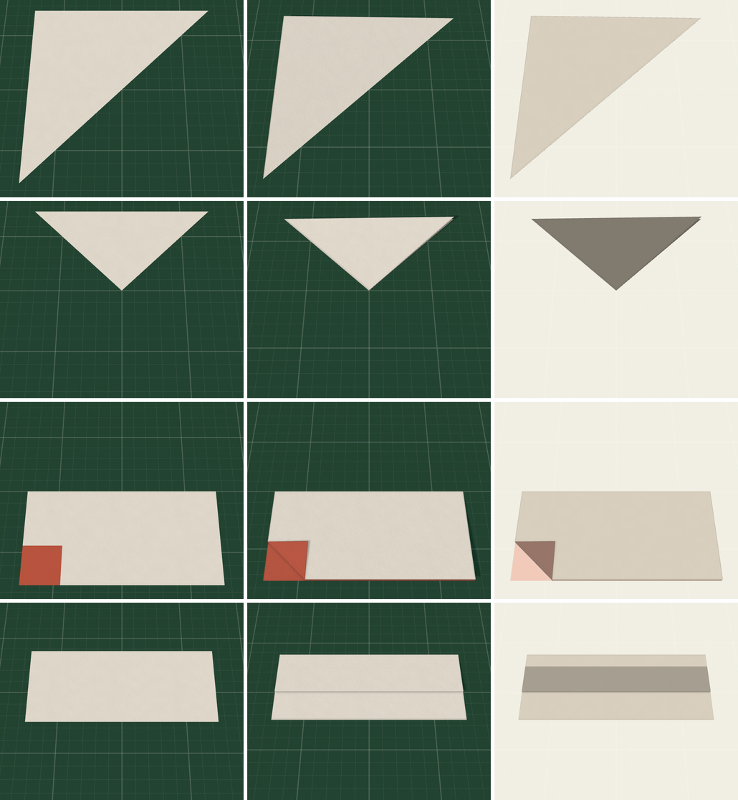
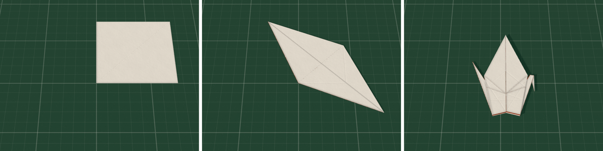
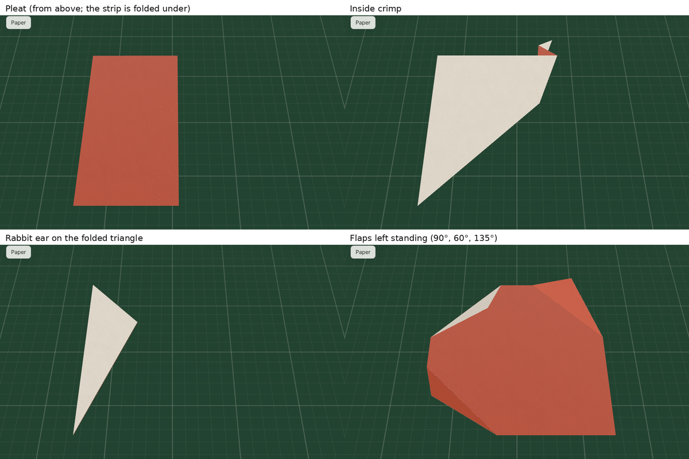

# Phase 2: progress notes

Phase 2 is "breadth and teaching", and its gate is the traditional crane end to end (PLAN.md).
This file tracks what's done, what isn't, and what's approximate. Decisions are in DECISIONS.md
(ADR-043 to ADR-051).

## Done

### A. Readable folded paper (plan 2 of PHASE-1-POLISH.md, ADR-043)

- Free flaps rest a few degrees open (real paper; at most 3 mm at the far end).
- Every state gets a layer map, drawn into two textures off the main thread. The paper shows:
  - contact shadows past every layer on top;
  - thin lines on cut edges;
  - rounded, lit folded edges;
  - ridges where an edge underneath presses through.
- **Lightbox:** hold L (a tap or the View switch keeps it on). Light comes from below, and each
  layer dims it, so hidden flaps show as darker steps.
- A lower camera and a more raking key light.

### B. Squash and petal folds (ADR-044, ADR-045)

- A general move for turning several parts of the paper at once, with a layer-order solver.
  Squash and petal folds are built on it, and reverse folds now go through it too.
- The kernel checks every result in full, as before. Every multi-part motion is tested to move
  without tearing.
- While you drag, the choice strip offers **Petal fold** and **Squash fold** (scroll or 1–9).
  The squash turns on the flap's own folded edge and the petal on the hinge the paper gives it,
  wherever the drag's line is, so both are there as soon as you pick up the flap.

### C. The crane

`kernel/test/crane.ts` folds a 150 mm square into a traditional crane in 21 moves:

1. Diagonal fold, then fold in half again.
2. Squash, turn over, squash (preliminary base).
3. Kite precreases.
4. Petal fold, turn over, petal fold (bird base).
5. Narrow the four leg edges.
6. Reverse fold the neck and the tail; they go up between the wings.
7. Reverse fold the head. Rotate.

Tests:

- The kernel accepts every step and every state validates in full.
- The build steps name both squashes, both petals and all three reverse folds, recognize the
  preliminary and bird bases, and replay from a flat sheet to the same crane. The squash and
  petal steps have hands.
- In the app, the whole sequence plays with its animations and no errors. The e2e tests make the
  first squash and a petal by pointer.

### D. Teaching (ADR-046, ADR-047)

- **Bases:** kite, blintz, preliminary, waterbomb and bird, recognized from where the paper is
  (in any order of folding, either side up). A chip names the base in the timeline and steps.
- **Repeats:** "repeat behind" and "repeat on the other side" are found and marked.
- **Difficulty:** 1 (very easy) to 5 (complex), from weighted moves and stack depth.
- **Diagrams:** Export, then Diagram (SVG) draws the steps in the Yoshizawa–Randlett vocabulary;
  print it for a PDF. **FOLD with steps** writes one frame per step.
- **Follow-along:** "Fold along" in the steps player starts a flat sheet beside the design's
  steps. The panel moves on when your paper matches the next step (or a later one), and says so
  when it matches none.
- **Timeline branches**, the **mirror tool** (M), and **paper sounds and haptics**.

### E. More moves (ADR-048, ADR-049)

- **Pleat:** a valley on the first line and the part past the second folded back on top.
- **Crimp**, inside and outside: both sides of a closed flap pleated at once. The lines decide
  which kinds are possible, and a kind they don't allow is refused.
- **Swivel:** a pleat whose lines meet on the paper, so the far part turns about that point.
- **Rabbit ear:** on a triangle, the sides fold in on the bisectors and the ear lies between them.
- Each one is named from what changed, captioned, drawn in the diagrams (valley and mountain
  lines, arrows), animated rigidly without tearing, and offered from the pointer:
  - While dragging a fold, the strip adds **Pleat**, and **Inside/Outside crimp** where the flap
    could be reverse folded on that line. The second line is a precrease past the drag's line,
    or halfway to where you grabbed.
  - Pressing near a corner of the model adds **Rabbit ear**; the ear lies toward the side you
    drag.

### F. Partial angles (ADR-050)

- A fold can stop partway: its flap stays standing open at that angle.
  - Hold **Alt** while dragging to hold the fold line and raise or lower the flap.
  - Release with Alt to leave it there.
  - **[** opens the last fold by 15° and **]** closes it; all the way closed, it lies flat.
- The kernel's state stays flat. A pose says which free flap stands open and how far.
  - A flap can stand only if nothing lies on it and it's joined only along its hinge.
  - Standing flaps can't run into each other.
  - Folds elsewhere are checked against them.
  - Anything that would move a standing flap is refused with "A flap is standing open. Press ]
    to lay it down."
- FOLD export draws standing flaps where they stand and round-trips them. Steps say where to
  stop ("…but stop at 90° and leave it standing").

## Not done (in order)

1. **Spreading the crane's wings, or folding them down flat.** After the legs are narrowed, each
   wing is joined at its narrowed corners to the body's inner layers.
   - A rigid fold of one wing, flat or partway, is refused as `joined`; real paper bends a little
     there.
   - The crane is drawn wings up.
   - This needs bending in the kernel (non-rigid regions), not more rigid moves.
2. **Spread squash.**
3. **Non-free flaps at partial angles, and 3D shaping** (puffing a body, curling): the same
   limit as item 1.
4. **The bend in a vertex shader** (a performance item). The CPU skin keeps up with the crane
   on the test machine.
5. **The whole crane as an e2e test driven by the pointer.** Today the e2e tests make one squash
   and one petal by pointer, and the full sequence plays through the dev hook.

## What stays approximate

- **Readability look.** The shadow width, line weights, bevel and ridge heights, the rest lift
  cap and per-layer transmission are tuned by eye (ADR-043).
- **The petal's side flaps** end up on the petal's face, as kite folds put them. That's the only
  stacking the creases allow with the inner layers kite-folded.
- **Squash, petal, rabbit ear, pleat and crimp motions** are exact rigid motions (no tearing).
  They are one path among several the paper could take; real paper also flexes.
- **A crimp's two sides** move together, like a pleat of the whole flap. The strip and far part
  reach their places between (inside) or around (outside) the flap's layers as they land; real
  paper opens the flap a little to let them in.
- **Standing flaps:**
  - They are checked against each other as thin plates, every 10° of the way, not as a swept
    volume.
  - Moves that could disturb one are refused rather than worked out.
  - They cast no contact shadows on the paper below.
- **The second line of a pleat or crimp** defaults to halfway to the grab point when there's no
  precrease to use.
- **Hands for multi-part steps** show where to push or pinch and where to hold, not every finger
  movement.
- **Sounds** are synthesized look-alikes, not recordings.
